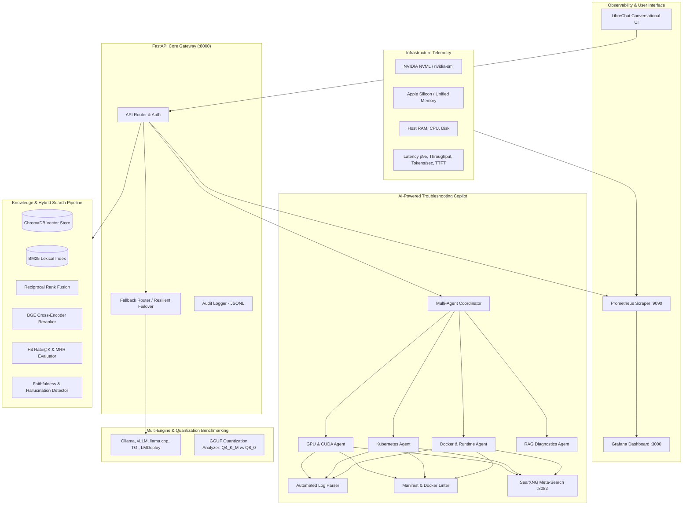

# OpenLLM Ops Intelligence 🚀

> **An AI-Powered LLM Infrastructure Monitoring, Management, and Troubleshooting Platform**

[](https://fastapi.tiangolo.com)
[](https://www.trychroma.com)
[](https://www.docker.com)
[](https://kubernetes.io)
[](https://prometheus.io)
[](https://grafana.com)

---

## Abstract

The rapid growth of Large Language Models (LLMs) has created new challenges in deploying, managing, monitoring, and optimizing AI infrastructure. Running LLMs efficiently requires effective management of computational resources, GPU utilization, memory allocation, inference performance, model deployment, and system reliability. Troubleshooting these environments also requires specialized knowledge of AI frameworks, containerization, GPU computing, and distributed infrastructure. 

**OpenLLM Ops Intelligence** is an integrated, open-source-first platform designed to simplify these operations through artificial intelligence, intelligent automation, infrastructure monitoring, and advanced Retrieval-Augmented Generation (RAG).

---

## System Architecture



---

## Key Features

### 1. Real-Time GPU & Infrastructure Observability
- **Hardware Telemetry**: Real-time extraction of GPU compute utilization (%), VRAM used vs total, GPU temperature (°C), power draw (W), and CUDA/driver versions via NVIDIA NVML / `nvidia-smi` with Apple Silicon Metal and CPU fallbacks.
- **Inference Performance**: Automated tracking of Time-to-First-Token (TTFT), tokens-per-second generation speed, rolling request throughput (req/s), and latency percentiles (P50, P95, P99).
- **Prometheus & Grafana**: Native Prometheus metrics exporter (`/metrics`) and turnkey Grafana dashboard.

### 2. Multi-Engine Benchmarking & GGUF Quantization Analyzer
- **Multi-Engine Evaluation**: Unified benchmarking harness for **Ollama**, **vLLM**, **llama.cpp**, **TGI**, and **LMDeploy**.
- **GGUF Quantization Trade-Off Analysis**: Analytical and empirical trade-off modeling between **Q4_K_M** and **Q8_0**:
  - Model file size calculation
  - Total VRAM requirements (Weights + KV Cache + CUDA Overhead)
  - Memory-bandwidth-bound theoretical throughput (tokens/sec)
  - Empirical Perplexity delta ($\Delta\text{PPL}$) relative to FP16.

### 3. Agentic AI Troubleshooting Copilot
- **Specialized Agents**:
  - `GPU-Infrastructure-Agent`: Diagnoses CUDA out-of-memory (OOM), driver Xid events, and thermal throttling.
  - `Kubernetes-Infrastructure-Agent`: Triage for `OOMKilled` (Exit Code 137), `CrashLoopBackOff`, GPU node taints/tolerations, and NVIDIA GPU Operator issues.
  - `Docker-Infrastructure-Agent`: Detects container shared memory `/dev/shm` Bus errors and NVIDIA Container Toolkit missing hooks.
  - `RAG-Diagnostics-Agent`: Analyzes context starvation, vector store health, and embedding timeouts.
- **Multi-Agent Orchestrator**: Automatically routes problem statements, invokes specialized tools, and synthesizes consensus root-cause diagnoses with step-by-step remediation commands.
- **Self-Hosted Web Search**: SearXNG integration for external documentation and GitHub issue lookup.

### 4. Advanced RAG Enhancements
- **Hybrid Retrieval**: Combines dense semantic search (ChromaDB) with BM25 keyword search using **Reciprocal Rank Fusion (RRF)**:
  $$\text{RRF Score} = \sum_{m \in M} \frac{1}{k + r_m(d)}$$
- **Cross-Encoder Reranking**: Uses `BAAI/bge-reranker-base` to re-score candidate chunks for maximum precision.
- **Metadata Filtering**: Filter queries by document category, source, or custom tags.
- **Retrieval Accuracy Evaluation**: Computes Hit Rate@K, Mean Reciprocal Rank (MRR), and Context Relevancy.
- **Hallucination Detection**: Extracts factual statements from LLM responses and calculates word-level grounding ratios against retrieved context.

### 5. Centralized Model Registry, Health & Resilient Routing
- **Model Registry**: Centralized catalog of models, parameter sizes, quantization profiles, and recommended hardware tiers.
- **Health Probes**: Continuous heartbeat and latency checks across all running inference engines.
- **Automated Failover Router**: Automatically routes requests to alternative backends (e.g. `vLLM` $\rightarrow$ `Ollama` $\rightarrow$ `llama.cpp`) if the primary engine fails.
- **Audit Logging**: Structured JSONL audit trails recording all queries, latency, tokens generated, and failover events.

### 6. Containerization & Kubernetes Deployment
- **Docker Compose**: Single-command orchestration for FastAPI backend, ChromaDB, Ollama, SearXNG, Prometheus, Grafana, and LibreChat.
- **Kubernetes Manifests**: Production YAML manifests with GPU requests (`nvidia.com/gpu: 1`), dedicated GPU node taints/tolerations, `/dev/shm` emptyDir mounts, and NVIDIA GPU Operator specifications.

---

## API Endpoints Reference

| Category | Method | Endpoint | Description |
| :--- | :--- | :--- | :--- |
| **System** | `GET` | `/` | Service information and status |
| **System** | `GET` | `/health` | Health check endpoint |
| **Monitoring** | `GET` | `/api/monitoring/gpu` | Real-time GPU utilization, VRAM, and temperature |
| **Monitoring** | `GET` | `/api/monitoring/system` | Host CPU, RAM, swap, and disk metrics |
| **Monitoring** | `GET` | `/api/monitoring/inference` | Inference latency percentiles, throughput, and tokens/sec |
| **Monitoring** | `GET` | `/metrics` | Prometheus exposition endpoint |
| **Benchmarking** | `POST` | `/api/benchmark/run` | Benchmark latency and throughput across engines |
| **Benchmarking** | `GET` | `/api/benchmark/quantization` | GGUF quantization trade-off analysis (Q4_K_M vs Q8_0) |
| **Copilot** | `POST` | `/api/copilot/diagnose` | Multi-agent infrastructure troubleshooting and triage |
| **Copilot** | `POST` | `/api/copilot/analyze-log` | Automated log parsing for CUDA, Docker, and K8s errors |
| **Copilot** | `POST` | `/api/copilot/inspect-config` | Lints K8s manifests or Docker configs for GPU best practices |
| **Copilot** | `GET` | `/api/copilot/search` | SearXNG self-hosted web search |
| **Registry** | `GET` | `/api/registry/models` | List registered models and quantization formats |
| **Registry** | `GET` | `/api/registry/health` | Active health check across inference backends |
| **Registry** | `POST` | `/api/registry/route` | Resilient inference with automated failover |
| **Registry** | `GET` | `/api/audit/logs` | Query structured audit events |
| **RAG** | `POST` | `/api/rag/ask` | Full Hybrid RAG query (Dense + BM25 + BGE Rerank + Qwen) |
| **RAG** | `POST` | `/api/rag/search-filtered` | Metadata-filtered hybrid search |
| **RAG** | `POST` | `/api/rag/evaluate` | Evaluates retrieval metrics (Hit Rate@K, MRR) |
| **RAG** | `POST` | `/api/rag/check-hallucination` | Faithfulness scoring and hallucination detection |
| **RAG** | `POST` | `/api/documents/upload` | Ingest PDF, Markdown, or TXT documentation |

---

## Quickstart Guide

### 1. Local Development

```bash
# Clone the repository
git clone https://github.com/BilalSubair/OpenLLM-Ops-Intelligence.git
cd OpenLLM-Ops-Intelligence/backend

# Install dependencies
pip install -r requirements.txt

# Run the test suite
python -m unittest test_monitoring.py test_quantization.py test_copilot_tools.py test_agents.py test_registry.py test_rag_advanced.py

# Launch the FastAPI backend
uvicorn main:app --reload --port 8000
```

### 2. Docker Compose Deployment

```bash
cd docker
docker-compose up -d
```
Access the services:
- **API & Docs**: [http://localhost:8000/docs](http://localhost:8000/docs)
- **Grafana Dashboard**: [http://localhost:3000](http://localhost:3000) (admin / admin)
- **Prometheus**: [http://localhost:9090](http://localhost:9090)
- **SearXNG**: [http://localhost:8082](http://localhost:8082)
- **LibreChat UI**: [http://localhost:3080](http://localhost:3080)

### 3. Kubernetes Deployment

```bash
# Apply namespace, PVCs, GPU deployment, and service
kubectl apply -f k8s/namespace.yaml
kubectl apply -f k8s/deployment.yaml
kubectl apply -f k8s/service.yaml
kubectl apply -f k8s/ingress.yaml
```

---

## License

This project is licensed under the Apache 2.0 License.
